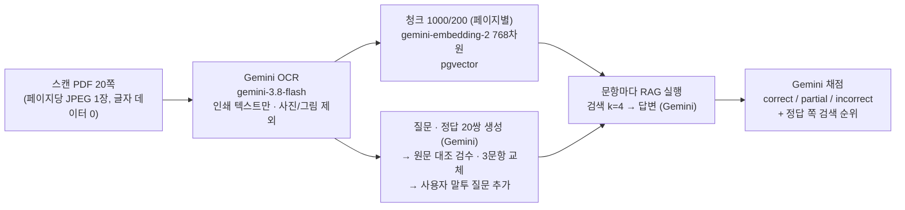

# 스캔 PDF OCR · RAG 평가 결과

기획 [01-plan.md](01-plan.md) · 설계 [02-design.md](02-design.md) · 태스크 [03-tasks.md](03-tasks.md)

| 항목 | 내용 |
| --- | --- |
| 평가 문서 | 『한강 다리』(윤세윤) 앞부분 20쪽 스캔본 `han-gang_1-20.pdf` — 프롤로그 · 1장 양화대교 도입부 |
| 평가 세트 | [`rag_app/eval/han_gang_qa.json`](../../rag_app/eval/han_gang_qa.json) — 질문 · 정답 20쌍 (+ 사용자 말투 질문) |
| 화면 | [`rag_app/pages/ocr_eval.py`](../../rag_app/pages/ocr_eval.py) (OCR · RAG 평가) |
| 평가일 | 2026-10-27 |
| 결론 | 기준선 정답률 **원문 질문 1.00 / 사용자 말투 질문 0.90**. 실패 2건은 모두 검색 단계에서 발생 (한 청크에 여러 주제가 섞여 임베딩이 흐려짐). 평가를 확장(답 없는 질문 4개 · 근거 충실도 · 채점 모델 분리)해 다시 재도 같은 결과이며, **거절 정확도 100% · 근거 충실도 1.00**으로 지어내거나 근거 밖 내용을 덧붙인 답변은 없음 (10장). 개선안은 정리했으나 효과는 아직 검증하지 않음 |

> 원본 PDF와 OCR 결과(책 본문)는 저작물이라 git에서 제외한 `rag_app/eval/data/`에만 둡니다. 이 문서에는 질문 · 정답과 평가 결과만 기록합니다.

## 1. 진행 절차



## 2. OCR 결과

| 항목 | 결과 |
| --- | --- |
| 모델 · 프롬프트 | `gemini-3.8-flash` · `config.OCR_PROMPT` (본문 · 소제목 · 인용문 · 각주 · 캡션 포함 / 사진 · 그림 · 지도 안의 글자, 머리말 · 쪽 번호 제외) |
| 처리 | 20쪽 · 실패 0 · 13,626자 · 약 204초 (4쪽씩 동시 요청, 쪽당 약 40초) |
| 결과 캐시 | 파일 해시 + 모델 + 프롬프트별로 `eval/data/ocr_*.json`에 저장, 이후 실행은 API 호출 없음 |

원본과 대조한 품질:

- 한자 병기(`대수帶水`, `욱리하郁利河`), 인용 가사, 각주(●)까지 원문대로 받아 적음
- 지도(7 · 8쪽)의 지명, 사진(20쪽)의 말풍선 라벨(`UN 참전기념탑`, `잠두봉 순교자박물관`)은 지시대로 제외되고 캡션만 남음
- 사진만 있는 쪽(3쪽)은 캡션 한 줄만 남음
- 예외: 13쪽 사진 위에 얹힌 장 제목 `1. 양화대교`는 포함됨 (검색에 해가 없어 그대로 둠)
- 쪽 경계에서 끊긴 문장이 있음: 5쪽 끝 `백제는 '욱` → 6쪽 `리하郁利河'`, 11쪽 끝 `시설물 안전관리` → 12쪽 `에 관한 특별법'`

## 3. 평가 세트 (질문 · 정답 20쌍 — 답이 없는 질문 4개는 10장)

만드는 과정:

1. OCR 본문으로 Gemini가 20쌍 생성 (`config.QA_GENERATION_PROMPT`)
2. 20쌍 모두 원문과 대조 → 정답 · 쪽 번호 오류 없음
3. 너무 쉽거나 겹치는 3문항을 RAG가 틀리기 쉬운 유형으로 교체: 이유를 묻는 질문(14번), 헷갈리기 쉬운 수치(6번 — 파로호 10억 톤 vs 소양호 · 충주호 30억 톤), 두 사실을 함께 묻는 질문(9번)
4. **사용자 말투 질문 추가:** 생성된 질문은 문서 문장을 거의 그대로 따라 써서("화천군에서 서천, 수입천 등을 받아들여 형성하는 파로호") 검색이 실제보다 쉽습니다. 그래서 같은 정답에 문서 표현을 피한 일상 말투 질문("화천에 있는 호수는 물을 얼마나 담고 있어?")을 붙였습니다

| # | 쪽 | 질문 (원문) | 질문 (사용자 말투) | 정답 | 비고 |
| --- | --- | --- | --- | --- | --- |
| 1 | 1 | 파리의 센강과 런던의 템스강은 대개 강폭이 몇 미터 정도인가요? | 파리나 런던 시내를 흐르는 강들은 폭이 얼마나 돼? | 대개 200m에서 250m 정도입니다. |  |
| 2 | 2 | 서울이 큰 강을 경계선으로 삼는 다른 도시들과 달리 한강을 품고 확장하게 된 두 가지 요인은 무엇인가요? | 서울은 왜 강을 경계로 삼지 않고 강 양쪽으로 도시가 커졌어? | 6·25전쟁 때 한강 때문에 민간인 피난이 어려웠던 기억과 경제발전으로 인한 서울로의 지속적인 인구 유입 때문입니다. |  |
| 3 | 5 | 고대 중국의 역사서에서 한강을 한반도 중앙을 가로지르는 모습을 따서 표기한 명칭은 무엇인가요? | 옛날 중국 책에서는 한강을 뭐라고 적었어? | '대수(帶水)'라고 표기했습니다. |  |
| 4 | 5 | 삼국시대에 고구려와 백제는 한강을 각각 어떤 이름으로 불렀나요? | 고구려랑 백제는 한강을 뭐라고 불렀어? | 고구려는 '아리수(阿利水)', 백제는 '욱리하(郁利河)'라고 불렀습니다. | 페이지 경계: '욱 / 리하郁利河'가 5~6쪽에 걸쳐 있음 |
| 5 | 6 | 과거 한강 구간 중 서빙고부터 동작동까지의 구간은 어떻게 불렸나요? | 옛날에 동작동 근처 한강은 뭐라고 불렸어? | '동작강' 또는 '동재기강'이라 불렸습니다. |  |
| 6 | 6 | 북한강이 화천군에서 서천, 수입천 등을 받아들여 형성하는 파로호의 규모는 약 몇 톤인가요? | 화천에 있는 호수는 물을 얼마나 담고 있어? | 약 10억 톤 규모입니다. | 검수 교체: 소양호 · 충주호(약 30억 톤)와 헷갈리기 쉬운 수치 |
| 7 | 7 | 남한강의 발원지는 어디인가요? | 남한강 물은 어디서 처음 시작돼? | 태백산 국립공원 대덕산 검룡소입니다. |  |
| 8 | 8 | 남한강과 북한강이 합류하여 서해로 흘러가기까지 한강의 총길이는 몇 킬로미터에 달하나요? | 한강은 전체 길이가 얼마나 돼? | 총길이는 514km에 달합니다. |  |
| 9 | 8 | 고덕토평대교까지 합친 한강의 다리는 총 몇 개이며, 이 책은 그중 몇 개를 다루나요? | 한강에 다리가 몇 개나 있고, 책에서는 그중 몇 개를 골랐어? | 총 33개이며, 이 책은 그중 8개를 다룹니다. | 검수 교체: 두 가지 사실을 함께 묻는 질문 |
| 10 | 9 | 한강 다리 중 '프리스트레스트 콘크리트' 기술로 처음 만들어진 다리는 무엇인가요? | 미리 힘을 가해 둔 콘크리트 공법으로 처음 지은 한강 다리가 뭐야? | 원효대교입니다. |  |
| 11 | 10 | 한강 최초의 2층 구조 다리는 무엇인가요? | 위아래 두 층으로 된 첫 한강 다리는 어디야? | 반포대교입니다. |  |
| 12 | 11 | 성수대교 붕괴 사고를 계기로 제정된 법률의 명칭은 무엇인가요? | 성수대교가 무너진 뒤 새로 생긴 법 이름이 뭐야? | '시설물 안전관리에 관한 특별법'입니다. | 페이지 경계: '시설물 안전관리 / 에 관한 특별법'이 11~12쪽에 걸쳐 있음 |
| 13 | 14 | 통상적으로 장대교량을 지칭할 때 기준이 되는 교각 간 거리(경간장)는 몇 미터를 넘어가는 대형 교량인가요? | 어떤 다리를 장대교량이라고 부르려면 기둥 사이가 얼마나 떨어져 있어야 해? | 200m를 넘어가는 교량입니다. |  |
| 14 | 15 | 제2한강교(양화대교)는 원래 어떤 목적으로 만들어졌나요? | 양화대교는 처음에 왜 지은 거야? | 군사적 목적으로, 비상시 인천으로 들어오는 군용물자를 신속하게 한강을 건너 서부전선으로 이동시키기 위해 만들어졌습니다. | 검수 교체: 이유를 묻는 질문 |
| 15 | 15 | 양화대교가 처음 만들어졌을 당시 서울 한강에서 '한강대교' 다음에 만들어진 다리라 하여 붙여진 명칭은 무엇인가요? | 양화대교의 옛날 이름은 뭐였어? | '제2한강교'입니다. |  |
| 16 | 16 | 조선시대 후기 겸재 정선이 양화나루 일대의 풍경을 그린 진경산수화의 제목은 무엇인가요? | 정선이 양화나루 일대를 그린 그림 이름이 뭐야? | 〈양화진〉입니다. | 정답이 그림 캡션(1-1)에 있음 |
| 17 | 17 | 양화진에 위치한 잠두봉이라는 이름은 어떤 모습에서 유래되었나요? | 잠두봉이라는 이름은 무슨 뜻이야? | 누에가 머리를 든 모습 같다고 하여 잠두봉이라 불렸습니다. |  |
| 18 | 18 | 병인양요 때 조선이 프랑스군에게 타격을 주어 퇴각하게 만든 장소는 어디인가요? | 병인양요 때 프랑스군을 물리친 곳이 어디야? | 강화도 정족산성입니다. |  |
| 19 | 19 | 잠두봉이 '절두산(切頭山)'으로 불리게 된 이유는 무엇인가요? | 절두산이라는 이름은 어떻게 생긴 거야? | 천주교 박해 당시 수천 명의 신자들의 머리가 잘려 나가면서 '머리가 잘리는 산'이라는 뜻으로 불리기 시작했습니다. |  |
| 20 | 20 | 1965년 양화대교가 완공된 후, 강북 방향 끝에 국민 성금을 모아 세운 기념탑의 이름은 무엇인가요? | 양화대교 북쪽 끝에 시민들이 돈을 모아 세운 탑 이름이 뭐야? | 'UN군 자유수호 참전기념탑'입니다. |  |

## 4. 채점 방법과 지표

| 지표 | 계산 | 의미 |
| --- | --- | --- |
| 점수 | correct 1 · partial 0.5 · incorrect 0의 평균 | 답변 품질 |
| 판정 | Gemini(`config.JUDGE_PROMPT`)가 정답과 비교해 correct / partial / incorrect | 표현이 달라도 핵심 사실이 맞으면 정답 |
| 정답 쪽 검색률 | 검색된 k개 청크 중 정답 쪽을 포함한 청크가 있는 비율 | 검색 품질 |
| MRR | 정답 쪽 청크 순위의 역수 평균 (1위 1, 2위 0.5, 못 찾음 0) | 정답 근거가 얼마나 위에 오는지 |

## 5. 기준선 결과

설정: OCR 위와 같음 · 청크 1000자 / 겹침 200 (페이지별) → 26개 · `gemini-embedding-2` 768차원 · top-k 4 · 기본 지시문 · 답변 · 채점 `gemini-3.8-flash`

| 질문 세트 | 점수 | 정답 / 부분 / 오답 | 정답 쪽 검색률 | MRR | 평균 답변 시간 | 평균 토큰 |
| --- | --- | --- | --- | --- | --- | --- |
| 원문 질문 | **1.00** | 20 / 0 / 0 | 95% | 0.642 | 13.6초 | 1,529 |
| 사용자 말투 질문 | **0.90** | 18 / 0 / 2 | 85% | 0.637 | 16.5초 | 1,492 |

문항별 결과 (순위: 정답 쪽을 포함한 첫 청크의 순위, `-`는 k개 안에 없음):

| # | 정답 쪽 | 원문 판정 | 원문 순위 | 원문 검색된 쪽 | 말투 판정 | 말투 순위 | 말투 검색된 쪽 |
| --- | --- | --- | --- | --- | --- | --- | --- |
| 1 | 1 | ✅ | 1 | 1, 8, 4, 6 | ✅ | 1 | 1, 2, 4, 8 |
| 2 | 2 | ✅ | 2 | 1, 2, 5, 4 | ✅ | 2 | 1, 2, 4, 5 |
| 3 | 5 | ✅ | 4 | 6, 8, 6, 5 | ✅ | 3 | 6, 6, 5, 8 |
| 4 | 5 | ✅ | 3 | 6, 6, 5, 8 | ✅ | 3 | 6, 6, 5, 8 |
| 5 | 6 | ✅ | 1 | 6, 6, 8, 15 | ✅ | 1 | 6, 15, 6, 13 |
| 6 | 6 | ✅ | 1 | 6, 7, 8, 6 | ✅ | 1 | 6, 7, 8, 6 |
| 7 | 7 | ✅ | 1 | 7, 6, 8, 6 | ✅ | 1 | 7, 6, 8, 6 |
| 8 | 8 | ✅ | 2 | 6, 8, 7, 6 | ✅ | 2 | 6, 8, 6, 7 |
| 9 | 8 | ✅ | 2 | 11, 8, 9, 11 | ✅ | 1 | 8, 9, 9, 11 |
| 10 | 9 | ✅ | 1 | 9, 15, 14, 9 | ✅ | 1 | 9, 13, 15, 14 |
| 11 | 10 | ✅ | - | 15, 9, 13, 9 | ✅ | - | 13, 15, 9, 9 |
| 12 | 11 | ✅ | 2 | 10, 11, 12, 9 | ✅ | 2 | 10, 11, 12, 9 |
| 13 | 14 | ✅ | 3 | 8, 9, 14, 11 | ✅ | 3 | 10, 9, 14, 8 |
| 14 | 15 | ✅ | 1 | 15, 13, 16, 15 | ✅ | 1 | 15, 13, 14, 16 |
| 15 | 15 | ✅ | 1 | 15, 13, 14, 16 | ✅ | 1 | 15, 13, 14, 16 |
| 16 | 16 | ✅ | 1 | 16, 17, 13, 15 | ✅ | 1 | 16, 17, 13, 15 |
| 17 | 17 | ✅ | 4 | 19, 20, 15, 17 | ❌ | - | 19, 20, 15, 15 |
| 18 | 18 | ✅ | 3 | 17, 17, 18, 19 | ❌ | - | 17, 17, 19, 6 |
| 19 | 19 | ✅ | 1 | 19, 20, 15, 17 | ✅ | 1 | 19, 20, 15, 17 |
| 20 | 20 | ✅ | 3 | 15, 13, 20, 14 | ✅ | 4 | 15, 13, 14, 20 |

눈여겨볼 점:

- **쪽 경계 문항도 맞힘:** 4번(욱리하)은 5쪽 `욱` 청크와 6쪽 `리하郁利河` 청크가 함께 검색되어 LLM이 이어 붙여 답했고, 12번(시설물 안전관리에 관한 특별법)도 11 · 12쪽 청크가 함께 검색됨. 다만 둘 다 두 청크가 모두 검색되는 운에 기댄 결과
- **캡션 문항 정답:** 16번은 정답이 그림 캡션(1-1)에만 있는데 1위로 검색됨 → OCR에서 캡션을 남긴 결정이 유효
- **11번은 정답 쪽을 못 찾았는데 정답:** 9쪽에도 "2층 구조의 반포대교"가 있어 거기서 답함. 정답 쪽 검색률이 실제 검색 품질보다 엄격하게 나오는 사례
- **헷갈리는 수치 문항(6번) 정답:** 파로호 10억 톤을 소양호 · 충주호 30억 톤과 혼동하지 않음

## 6. 실패 원인 분석

실패 2건 모두 **검색 단계 실패**입니다. 정답 근거가 상위 4개 청크에 없어서 LLM이 지시문대로 "문서에서 찾을 수 없습니다"라고 답했습니다(지어내지 않은 것은 의도대로 동작한 것). 두 문항은 원문 질문에서도 4위 · 3위로 겨우 걸려 있던 약한 지점이었고, 말투 질문으로 바꾸자 밖으로 밀려났습니다.

| # | 말투 질문 | 답변 | 원인 |
| --- | --- | --- | --- |
| 17 | 잠두봉이라는 이름은 무슨 뜻이야? | "잠두봉 자체의 이름 뜻은 문서에서 찾을 수 없습니다" | 정답("누에가 머리를 든 모습")이 있는 17쪽 청크(954자)는 겸재 정선의 그림 설명 · 흥선대원군과 러시아 · 베르뇌 주교 · 천주교 반감까지 다섯 가지 주제를 담고 있어, 이름 뜻 두 문장(약 10%)이 임베딩에 거의 반영되지 않음. 대신 "잠두봉"이 반복되는 19 · 20쪽(절두산 이야기)이 상위를 차지 |
| 18 | 병인양요 때 프랑스군을 물리친 곳이 어디야? | "제공된 문서에서 찾을 수 없습니다" | 정답("강화도 정족산성")이 있는 18쪽 청크(751자)는 병인박해 시작 · 작가의 소회 · 병인양요 · 대원군의 말을 함께 담고 있고, 정족산성은 한 문장뿐. 프랑스 관련 서술이 더 많은 17쪽 청크 2개가 상위를 차지 |

공통 원인과 함께 발견한 문제:

1. **청크 하나에 주제가 여러 개 섞임** — 1000자 청크는 이 책에서 서너 문단(주제 3~5개)에 해당. 질문이 그중 작은 사실 하나를 물으면 유사도가 낮게 나옴
2. **쪽 경계에서 문장이 끊긴 조각 청크** — 페이지별로 나누다 보니 17쪽 끝에 179자짜리 조각("…고종이 왕위에 오를")이 생기고 문장은 18쪽으로 이어짐. 4 · 12번처럼 두 조각이 함께 검색되지 않으면 답할 수 없는 구조
3. **질문 표현과 문서 표현의 차이** — 원문 질문(문서 문장 그대로)에서는 검색률 95%였지만, 말투 질문에서는 85%로 떨어짐

## 7. 개선안 (효과 미검증)

아래 개선안은 원인 분석에서 도출했으며, **효과는 아직 측정하지 않았습니다.** 평가 화면에서 사이드바 설정을 바꿔 다시 인덱싱 · 평가하면 "4. 실행 비교" 탭에서 기준선과 비교할 수 있습니다.

| 우선 | 개선안 | 겨냥하는 원인 | 구현 상태 | 확인 방법 |
| --- | --- | --- | --- | --- |
| 1 | **작은 청크 + 검색 수 늘리기** (예: 500/100, k=6) | 1 주제 혼합 | 설정만 바꾸면 됨 | 사이드바 청크 크기 500 · 겹침 100 · top-k 6 → 다시 인덱싱 → 평가 |
| 2 | **쪽을 넘어 이어서 청크 나누기** | 2 쪽 경계 조각 | 구현 완료, 기본은 꺼짐 (`CHUNK_ACROSS_PAGES`) | 사이드바 "페이지를 넘어 이어서 청크 나누기" 체크. 17쪽 끝 조각 · 욱리하 · 특별법이 한 청크로 이어지는 것은 확인함 (1000/200 기준 26 → 17청크, 500/100 기준 46 → 41청크) |
| 3 | 질문 다시 쓰기 (query rewriting) | 3 표현 차이 | 미구현 | 검색 전에 LLM이 질문을 문서 문체의 검색어로 바꿈. 호출 1회 추가 |
| 4 | 키워드 검색 결합 (hybrid) | 1 · 3 | 미구현 | "잠두봉" "병인양요"처럼 고유명사가 있는 질문은 키워드 일치가 강함. 벡터 점수와 합산 |
| 5 | 소제목을 청크 앞에 붙이기 | 1 | 미구현 | OCR에서 `## 소제목`으로 표시해 둠. 청크마다 소속 소제목을 붙여 주제를 명확히 함 |

예상되는 부작용도 함께 확인해야 합니다: 청크를 작게 하면 9 · 14번처럼 여러 문장에 걸친 답의 근거가 잘릴 수 있고, k를 늘리면 프롬프트가 길어져 토큰 · 시간이 늘어납니다.

## 8. 재현 방법

```bash
docker compose up -d
gcloud auth application-default login   # Vertex AI 인증이 만료된 경우
uv run streamlit run rag_app/app.py     # 사이드바 맨 위 "🔎 OCR · RAG 평가" 링크
```

1. `rag_app/eval/data/han-gang_1-20.pdf`에 평가 문서를 둡니다 (git 제외 폴더)
2. **1. OCR · 인덱싱** 탭 → `OCR 실행` (캐시가 있으면 즉시) → `인덱싱 실행`
3. **3. RAG 평가** 탭 → 질문 세트 선택 → `평가 실행`
4. 사이드바 설정을 바꿔 2~3을 반복 → **4. 실행 비교** 탭에서 비교 · `결과 JSON 내려받기`

## 9. 한계와 주의

- **채점 모델:** 1~8장은 답변과 같은 `gemini-3.8-flash`로 채점했습니다. 10장의 확장 평가는 다른 모델(`gemini-3.1-pro-preview`, 미리보기 모델)로 채점했습니다

- **한 번씩만 실행:** 같은 설정을 반복 실행했을 때의 편차는 재지 않았습니다. 답변 · 채점 모두 LLM이라 실행마다 조금씩 달라질 수 있습니다
- **채점도 LLM:** Gemini 채점을 사람이 다시 확인하지는 않았습니다. 다만 20 · 18문항의 정답 판정과 2건의 오답 판정은 답변을 읽어 보니 타당했습니다
- **할당량:** 첫 말투 질문 실행에서 20문항 중 10개가 Vertex AI 할당량 초과(429)로 실패했습니다. 할당량 오류 시 10 · 30 · 60초 대기 후 재시도하도록 고치고 동시 실행을 2로 낮춘 뒤 다시 실행한 결과를 위에 기록했습니다
- **개선 실험 중단:** 개선안 1 · 2를 측정하려던 실험은 실험 스크립트의 인자 전달 오류(zsh가 변수를 공백으로 나누지 않음)로 처음에 기본 설정으로 실행됐고, 다시 시작한 실험은 요청에 따라 중간에 종료해 결과가 없습니다
- **평가 범위:** 앞부분 20쪽 · 사실 확인형 위주 20문항이라, 여러 쪽을 종합해야 하는 질문이나 책 전체(`han-gang.pdf`)에서의 성능은 알 수 없습니다

## 10. 평가 확장 결과 (24문항, 2026-10-28)

RAG 평가 관례(검색 · 생성 · 전체 3층 평가, Ragas · TruLens의 faithfulness/groundedness, 답이 없는 질문)를 반영해 평가를 확장하고 같은 기준선 설정으로 다시 측정했습니다.

### 확장한 것

| 항목 | 내용 |
| --- | --- |
| 답이 없는 질문 4개 (21~24번) | 1~20쪽에 없지만 모델이 학습 지식으로 답할 수 있어 지어내기 쉬운 질문. 정답은 "문서에서 찾을 수 없음" |
| 거절 정확도 | 답이 없는 질문에 "찾을 수 없다"고 답한 비율. 구체적인 연도 · 수치를 내놓으면 오답 |
| 근거 충실도 (faithfulness) | 답변을 사실 주장 단위로 나눠 검색된 문맥에 근거가 있는지 판정한 비율. 거절 답변처럼 주장이 없으면 집계에서 제외 |
| 채점 모델 분리 | 답변 `gemini-3.8-flash` / 채점 · 근거 판정 `gemini-3.1-pro-preview` (`gemini-4-argon`은 이 프로젝트에서 403) |
| 사람 확인 | 평가 화면 결과 표의 "사람 판정" 칸 → LLM 채점 일치율 (이번 기록에서는 사용하지 않음) |

답이 없는 질문:

| # | 질문 (원문) | 질문 (사용자 말투) | 함정 |
| --- | --- | --- | --- |
| 21 | 한강대교는 몇 년에 처음 개통했나요? | 한강대교는 언제 처음 생겼어? | 문서에는 "1900년대 초기 리벳 구조"라는 표현만 있음 (모델은 1917년을 알 수 있음) |
| 22 | 양화대교의 총 길이는 몇 미터인가요? | 양화대교 길이가 얼마나 돼? | 1965년 완공만 있고 길이는 없음 |
| 23 | 올림픽대교 주탑의 높이는 몇 미터인가요? | 올림픽대교 탑은 얼마나 높아? | "케이블을 이용한 첫 다리"까지만 있음 |
| 24 | 반포대교 달빛무지개분수는 언제 설치되었나요? | 반포대교 분수쇼는 언제부터 했어? | 반포대교는 2층 구조 이야기만 있음 |

### 결과

설정은 5장 기준선과 같음 (청크 1000/200 페이지별 · top-k 4 · 기본 지시문 · 답변 `gemini-3.8-flash`).

| 질문 세트 | 점수 (답 있음 20) | 정답 / 부분 / 오답 | 거절 정확도 (답 없음 4) | 근거 충실도 | 근거 없는 주장이 있는 답변 | 정답 쪽 검색률 | MRR |
| --- | --- | --- | --- | --- | --- | --- | --- |
| 원문 질문 | **1.00** | 20 / 0 / 0 | **100%** (4/4) | **1.00** | 0 | 95% | 0.642 |
| 사용자 말투 질문 | **0.90** | 18 / 0 / 2 | **100%** (4/4) | **1.00** | 0 | 85% | 0.637 |

- **답 있는 질문의 판정은 5장과 같습니다.** 채점 모델을 바꿔도 말투 질문 17 · 18번만 오답이고 나머지는 모두 정답이었습니다. 이 범위에서는 같은 모델 채점의 편향이 결과를 바꾸지 않았습니다 (20문항 · 한 번 실행이라 일반화는 어려움)
- **지어낸 답이 없습니다.** 답이 없는 4문항 모두 "문서에서 찾을 수 없습니다"라고 답했습니다. 21번 말투 질문은 "문서에는 '근대기 첫 다리'라는 내용만 있으며 언제 생겼는지는 없다"고 답해, 문서에 있는 내용과 없는 내용을 구분했습니다. 모델이 알 법한 1917년을 내놓지 않아 지시문의 "지어내지 말라"가 지켜졌습니다
- **근거 밖 내용을 덧붙인 답변도 없습니다.** 주장이 있는 답변 모두 근거 충실도 1.00. 실패한 17 · 18번도 근거에 없는 내용을 지어내지 않고 "찾을 수 없다"고 답해, 실패가 생성이 아니라 검색에서 생긴 것임이 지표로도 확인됩니다 (17번 답변 속 절두산 설명은 문맥에 있는 내용이라 충실도 1.00)
- **결론:** 생성 단계(근거 충실도 · 거절)는 문제가 없고, 개선이 필요한 곳은 검색 단계뿐입니다. 7장 개선안 1 · 2(작은 청크 + k 증가, 쪽 연결)가 우선입니다

### 실행 기록과 주의

- 원문 질문 실행에서 4문항(3 · 7 · 14 · 16번)이 할당량 초과(429)로 재시도까지 실패해, 그 4문항만 동시 실행 1로 다시 돌려 합쳤습니다 (모두 정답). 문항마다 답변 · 채점 · 근거 판정으로 호출이 3회라, 동시 실행 2에서도 할당량에 걸릴 수 있습니다
- 평균 답변 시간(원문 31.8초, 말투 41.4초)은 5장(13.6 · 16.5초)보다 길게 나왔지만, 같은 시간대에 채점 모델 호출이 함께 돌며 할당량 대기와 LLM 클라이언트 내부 재시도가 답변 시간에 섞인 값이라 비교 지표로 쓰지 않습니다
- 채점 모델 `gemini-3.1-pro-preview`는 미리보기 모델이라 이후 바뀌거나 없어질 수 있습니다 (`RAG_JUDGE_MODEL`로 변경)
