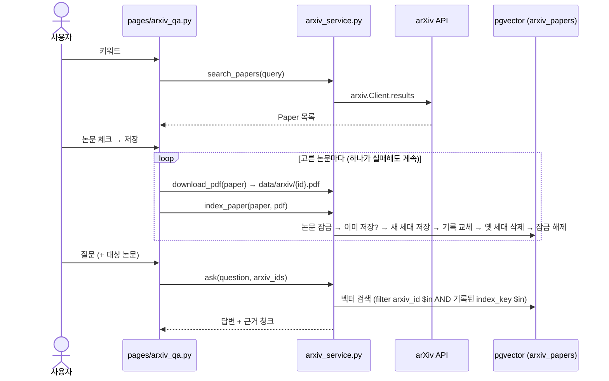
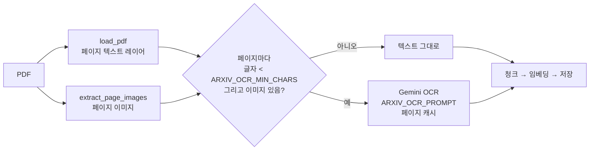
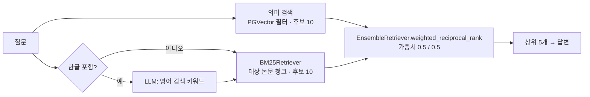

# arXiv 논문 검색 · 저장 · 질의 — 설계

## 흐름

## 인터페이스 (`rag_app/arxiv_service.py`)
| 함수 | 설명 | 입력 | 출력 |
|---|---|---|---|
| `search_papers` | R1 검색 | `query`, `max_results=10`, `client=None` | `list[Paper]` |
| `pdf_path_for` | 논문 ID → 로컬 PDF 경로 (미리보기 · 다운로드 공용) | `arxiv_id`, `data_dir` | `Path` |
| `download_pdf` | R2 다운로드 (있으면 재사용, `.part`로 받은 뒤 이름 변경) | `paper`, `data_dir`, `http_get=None` | `Path` |
| `index_paper` | R3 저장 (같은 index_key면 건너뜀) | `paper`, `pdf_path`, `embeddings`, `collection_name` | `IndexResult(skipped, chunks)` |
| `list_indexed_papers` | 저장된 논문 목록 | `collection_name` | `list[dict]` |
| `paper_from_record` | 저장 기록 → `Paper` (PDF 주소가 없으면 `https://arxiv.org/pdf/{id}`) — R7 미리보기에서 파일이 없을 때 다시 받기용 | `record` | `Paper` |
| `ask` | R4 질의 | `question`, `llm`, `embeddings`, `collection_name`, `arxiv_ids=None`, `k` | `(answer, hits)` |

`Paper`: `arxiv_id`(버전 포함 short id) · `title` · `authors` · `published` · `summary` · `pdf_url`. 외부 의존(`client`, `http_get`, `embeddings`, `llm`)은 인자로 받아 테스트에서 가짜로 바꾼다.

## 데이터 설계
| 위치 | 내용 |
|---|---|
| `langchain_pg_embedding.cmetadata` (청크) | 기존 `source`(=논문 제목) · `page` · `file_sha256` + **`arxiv_id`** · **`index_key`**(세대) |
| `langchain_pg_collection.cmetadata` (컬렉션) | `{"papers": {arxiv_id: {title, authors, published, pdf_url, index_key, chunks, indexed_at}}}` |
| 파일 | `rag_app/data/arxiv/{arxiv_id}.pdf` (`/`는 `_`로, `.gitignore` 추가) |
| 컬렉션 이름 | `arxiv_papers_{임베딩 모델}_d{차원}` — 리뷰 반영: 모델이 바뀌면 벡터가 섞이지 않게 분리 |

`index_key` = 기존 `make_index_key(file_sha256, {chunk_size, chunk_overlap, across_pages, embedding_model, embedding_dim})`.
"이미 저장됨" = 목록의 `index_key`가 같고 실제 청크 수가 기록과 같음 (기존 `find_same_index`와 같은 기준).

## 선택지 비교

### 논문 목록 저장 위치
| 선택지 | 장점 | 단점 |
|---|---|---|
| A. 컬렉션 cmetadata의 `papers` | 기존 `find_same_index` 패턴과 동일, 테이블 추가 없음 | JSON 갱신을 원자적으로 해야 함 |
| B. 새 테이블 `arxiv_papers` | 조회 · 제약이 명확 | 스키마 생성 · 관리 코드가 늘어남 |

**선택**: A — 한 문장 `UPDATE … SET cmetadata = cmetadata::jsonb || …`로 원자적 갱신이 되고, 기존 코드와 같은 방식.

### 같은 논문 동시 저장 (동시성)
| 선택지 | 장점 | 단점 |
|---|---|---|
| A. 처리 없음 | 단순 | 두 탭이 동시에 저장하면 청크 중복 |
| B. 논문별 PostgreSQL advisory lock + 잠금 후 재확인 | 중복 없음, 다른 논문은 병렬 가능, DB만으로 해결 | 잠금용 연결을 저장 내내 유지 |
| C. 청크 id를 `{arxiv_id}:{i}`로 고정해 upsert | 잠금 없음 | 청크 수가 줄면 옛 청크가 남음, 결국 삭제 필요 |

**선택**: B — `pg_advisory_lock(hashtext(collection || arxiv_id))`. 뒤에 온 요청은 앞 요청이 끝난 뒤 재확인에서 "이미 저장됨"으로 건너뜀.

### 실패 시 일관성 (리뷰 반영으로 변경)
처음 설계(기존 청크 삭제 → 저장 → 기록)는 **재저장이 저장 도중 실패하면 기존 청크가 사라진 채 기록은 "저장됨"으로 남는** 문제가 있었다.
청크마다 `index_key`(세대)를 붙이고 순서를 바꾼다:

1. 같은 세대의 잔여 청크 삭제 (이전 실패가 남긴 것)
2. 새 세대 저장
3. 기록을 새 세대로 교체
4. 옛 세대 삭제

질의 · 청크 수 확인은 **기록된 세대만** 대상으로 하므로, 어느 단계에서 실패해도 이전 버전으로 계속 질의되고 다음 시도에서 복구된다 (R6).

## 구성 (파일)
| 파일 | 변경 |
|---|---|
| `rag_app/arxiv_service.py` | **새 파일** — 위 함수 · `Paper` · `IndexResult` |
| `rag_app/pages/arxiv_qa.py` | **새 파일** — 검색 → 체크 → 저장 → 질의 화면 |
| `tests/test_arxiv_service.py` | **새 파일** — pytest, 가짜 arXiv · HTTP · 임베딩 · LLM + 로컬 pgvector(테스트용 컬렉션, 끝나면 삭제) |
| `rag_app/config.py` | 상수 4개 추가: `ARXIV_COLLECTION_PREFIX`, `ARXIV_COLLECTION`, `ARXIV_DATA_DIR`, `ARXIV_MAX_RESULTS` |
| `rag_app/ui_common.py` | 사이드바 링크 한 줄 — 구현 중 추가: 앱이 자동 페이지 목록을 숨기고 링크를 직접 두므로 없으면 화면에 갈 수 없음. 리뷰 반영: 컬렉션 선택 목록에서 논문 컬렉션 제외 |
| `rag_app/app.py` | 리뷰 반영: 논문 컬렉션으로 인덱싱하면 OCR · 임베딩 전에 거부, 삭제 목록에서 제외 |
| `rag_app/pipeline.py` | 재리뷰 반영: `is_paper_collection(metadata)` 추가, `save_to_store`가 논문 컬렉션이면 거부 (다른 컬렉션 동작은 그대로) |
| `.gitignore` | `rag_app/data/` |
| `pyproject.toml` | 의존성 `arxiv` · `streamlit[pdf]`(R7 `st.pdf`), dev 의존성 `pytest` |

재사용: `pipeline.load_pdf · split_documents · embed_chunks · get_vector_store · make_index_key · embed_question · search_chunks · build_prompt · generate_answer`, 지시문 `config.SYSTEM_PROMPT`.

## 2차 추가: R8 OCR · R9 top-k · R10 하이브리드

### R8 페이지별 OCR

- PDF 유형: OCR 대상 0쪽 = `text`, 전체 = `image`, 일부 = `mixed`
- 재사용: `pipeline.GeminiImageReader(mark=None, empty_ok=True)` · `extract_page_images`. 캐시는 `rag_app/data/arxiv/ocr_pages/` (페이지 이미지 + 모델 + 프롬프트 해시, `evaluation.ocr_pdf`와 같은 방식)
- `index_key`에 OCR 페이지가 있을 때만 `ocr_model` · `ocr_prompt` 포함
- 기록에 `pdf_kind` · `ocr_pages` · `ocr_failures` · `ocr_warnings` 추가
  - `ocr_failures`(LLM 호출 실패 · 일시적일 수 있음)가 있으면 "이미 저장됨"으로 보지 않아 다음 저장에서 다시 OCR
  - `ocr_warnings`(디코딩 실패 · 단색 이미지 등 추출 문제)는 다시 해도 같으므로 표시만 하고 건너뛰기를 막지 않음 — 2차 리뷰 M2 반영
- `index_paper(..., ocr_llm=None)`: OCR이 필요한데 없으면 오류. 화면은 `get_llm(config.ARXIV_OCR_MODEL, IMAGE_MAX_OUTPUT_TOKENS)`을 넘김

### R9 · R10 하이브리드 검색

- BM25 말뭉치: 대상 논문의 **기록된 세대** 청크를 DB에서 읽어 만듦. 같은 대상(컬렉션 + (arxiv_id, index_key) 집합)이면 프로세스 안에서 캐시, 저장으로 세대가 바뀌면 키가 달라져 자동으로 다시 만듦
- 결합 시 **내용이 같은 청크는 하나로 합침** (`EnsembleRetriever` 기본 `id_key=None` → `page_content` 기준). v1 · v2처럼 본문이 같은 청크가 중복으로 근거를 차지하지 않음
- 토큰화: 소문자 + `\w+` (기본 `str.split`은 구두점이 붙어 "attention,"과 "attention"이 다른 단어가 됨)
- `ask` 반환 `hits`: `(Document, {"rrf_rank", "vector_rank", "bm25_rank"})` — 화면에 어느 검색에서 찾았는지 표시
- 상수: `ARXIV_TOP_K = 5`, `ARXIV_CANDIDATES = 10`, `ARXIV_HYBRID_WEIGHTS = (0.5, 0.5)` (BM25, 의미), `ARXIV_OCR_MIN_CHARS = 50`, `ARXIV_OCR_PROMPT`, `ARXIV_KEYWORD_PROMPT`

### 선택지 비교
| 결합 방식 | 장점 | 단점 |
|---|---|---|
| A. `EnsembleRetriever.invoke` | 한 줄 | 모든 리트리버에 같은 질문 → BM25에 영어 키워드를 따로 줄 수 없음 |
| B. 각각 검색 후 `weighted_reciprocal_rank`로 결합 | 리트리버마다 질문을 다르게, RRF는 LangChain 구현 그대로 | 호출 두 번을 직접 작성 |

**선택**: B — 한국어 질문 → 영어 키워드 결정을 지키면서 결합 로직은 LangChain 것을 씀.

| BM25 말뭉치 | 장점 | 단점 |
|---|---|---|
| 질문마다 DB에서 읽어 생성 | 항상 최신 | 논문이 늘면 질문마다 수백~수천 청크 로드 |
| 대상 · 세대 키로 캐시 | 반복 질문이 빠름, 세대가 바뀌면 자동 갱신 | 프로세스 메모리 사용 (논문 수십 편 규모에서 무시 가능) |

**선택**: 캐시.

| 파일 | 변경 |
|---|---|
| `rag_app/arxiv_service.py` | `analyze_pdf` · OCR 로딩 · BM25 캐시 · 키워드 변환 · 하이브리드 `ask` |
| `rag_app/config.py` | 위 상수 |
| `rag_app/pages/arxiv_qa.py` | 저장 결과에 PDF 유형 · OCR 쪽수, 근거에 검색 경로 표시 |
| `pyproject.toml` | `rank-bm25` |

### R11 논문 삭제 · R12 기존 데이터 이전
- `delete_paper(arxiv_id)`: 논문 잠금 → **기록 먼저 제거**(`cmetadata #- '{papers,id}'`, 이후 질의 · 목록에서 즉시 사라짐) → 모든 세대 청크 삭제. 청크 삭제가 실패해도 기록이 없어 검색되지 않고, 같은 논문을 다시 저장하면 잔여 청크를 정리
- `migrate_legacy_collection(old, new)`: 한 트랜잭션에서 ① 새 이름이 이미 있으면 중단 ② 컬렉션 이름 변경 ③ 청크마다 기록의 `index_key`를 metadata에 추가. 실패하면 전부 롤백. 기록 · 청크 수 · `index_key` 계산 방식이 지금과 같음을 확인했으므로 재임베딩 없음

### 2차 리뷰 반영: 저장마다 세대 id (M1)
`index_key`를 세대로 쓰면 **OCR 재시도처럼 같은 입력을 다시 저장할 때** "같은 세대 잔여 청크 삭제"가 지금 검색되는 청크를 지우고, BM25 캐시 키도 그대로라 옛 청크를 계속 씀.
- `index_key` = 같은 입력인가 (건너뛰기 판단만)
- `generation` = 저장 1회마다 `uuid4` — 청크 metadata · 기록 · 질의 필터 · 청크 수 · BM25 캐시 키는 모두 이것 기준
- 순서: 기록된 세대 외 잔여 청크 삭제 → 새 세대 저장 → 기록 교체 → 새 세대 외 삭제
- 세대 없는 옛 기록은 질의에서 제외되고 저장 시 다시 저장. `backfill_generation`이 `generation = index_key`로 채움 (한 트랜잭션, 다시 실행해도 그대로). `migrate_legacy_collection`도 이전하면서 채움
