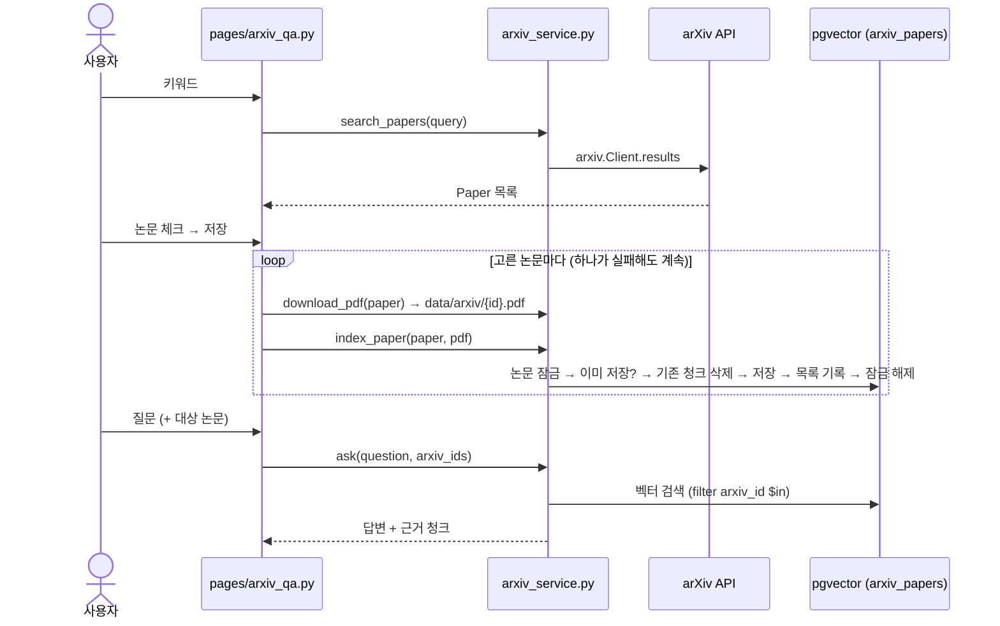

# arXiv 논문 검색 · 저장 · 질의 — 설계

## 흐름

## 인터페이스 (`rag_app/arxiv_service.py`)
| 함수 | 설명 | 입력 | 출력 |
|---|---|---|---|
| `search_papers` | R1 검색 | `query`, `max_results=10`, `client=None` | `list[Paper]` |
| `download_pdf` | R2 다운로드 (있으면 재사용, `.part`로 받은 뒤 이름 변경) | `paper`, `data_dir`, `http_get=None` | `Path` |
| `index_paper` | R3 저장 (같은 index_key면 건너뜀) | `paper`, `pdf_path`, `embeddings`, `collection_name` | `IndexResult(skipped, chunks)` |
| `list_indexed_papers` | 저장된 논문 목록 | `collection_name` | `list[dict]` |
| `ask` | R4 질의 | `question`, `llm`, `embeddings`, `collection_name`, `arxiv_ids=None`, `k` | `(answer, hits)` |

`Paper`: `arxiv_id`(버전 포함 short id) · `title` · `authors` · `published` · `summary` · `pdf_url`. 외부 의존(`client`, `http_get`, `embeddings`, `llm`)은 인자로 받아 테스트에서 가짜로 바꾼다.

## 데이터 설계
| 위치 | 내용 |
|---|---|
| `langchain_pg_embedding.cmetadata` (청크) | 기존 `source`(=논문 제목) · `page` · `file_sha256` + **`arxiv_id`** |
| `langchain_pg_collection.cmetadata` (컬렉션) | `{"papers": {arxiv_id: {title, authors, index_key, chunks, indexed_at}}}` |
| 파일 | `rag_app/data/arxiv/{arxiv_id}.pdf` (`.gitignore` 추가) |

`index_key` = 기존 `make_index_key(file_sha256, {chunk_size, chunk_overlap, across_pages, embedding_model, embedding_dim})`.
"이미 저장됨" = 목록의 `index_key`가 같고 실제 청크 수가 기록과 같음 (기존 `find_same_index`와 같은 기준).

## 선택지 비교

### 논문 목록 저장 위치
| 선택지 | 장점 | 단점 |
|---|---|---|
| A. 컬렉션 cmetadata의 `papers` | 기존 `find_same_index` 패턴과 동일, 테이블 추가 없음 | JSON 갱신을 원자적으로 해야 함 |
| B. 새 테이블 `arxiv_papers` | 조회 · 제약이 명확 | 스키마 생성 · 관리 코드가 늘어남 |

**선택**: A — 한 문장 `UPDATE … SET cmetadata = cmetadata::jsonb || …`로 원자적 갱신이 되고, 기존 코드와 같은 방식.

### 같은 논문 동시 저장 (동시성)
| 선택지 | 장점 | 단점 |
|---|---|---|
| A. 처리 없음 | 단순 | 두 탭이 동시에 저장하면 청크 중복 |
| B. 논문별 PostgreSQL advisory lock + 잠금 후 재확인 | 중복 없음, 다른 논문은 병렬 가능, DB만으로 해결 | 잠금용 연결을 저장 내내 유지 |
| C. 청크 id를 `{arxiv_id}:{i}`로 고정해 upsert | 잠금 없음 | 청크 수가 줄면 옛 청크가 남음, 결국 삭제 필요 |

**선택**: B — `pg_advisory_lock(hashtext(collection || arxiv_id))`. 뒤에 온 요청은 앞 요청이 끝난 뒤 재확인에서 "이미 저장됨"으로 건너뜀.

### 실패 시 일관성
기존 `save_to_store`처럼 **목록 기록을 맨 마지막에** 한다: 기존 청크 삭제 → 새 청크 저장 → 목록 기록. 중간에 실패하면 목록이 갱신되지 않아 다음 시도에서 다시 삭제 · 저장되므로 스스로 복구된다 (R6).

## 구성 (파일)
| 파일 | 변경 |
|---|---|
| `rag_app/arxiv_service.py` | **새 파일** — 위 함수 · `Paper` · `IndexResult` |
| `rag_app/pages/arxiv_qa.py` | **새 파일** — 검색 → 체크 → 저장 → 질의 화면 |
| `tests/test_arxiv_service.py` | **새 파일** — pytest, 가짜 arXiv · HTTP · 임베딩 · LLM + 로컬 pgvector(테스트용 컬렉션, 끝나면 삭제) |
| `rag_app/config.py` | 상수 3개 추가: `ARXIV_COLLECTION`, `ARXIV_DATA_DIR`, `ARXIV_MAX_RESULTS` |
| `.gitignore` | `rag_app/data/` |
| `pyproject.toml` | 의존성 `arxiv`, dev 의존성 `pytest` |

재사용: `pipeline.load_pdf · split_documents · embed_chunks · get_vector_store · make_index_key · embed_question · search_chunks · build_prompt · generate_answer`, 지시문 `config.SYSTEM_PROMPT`.
